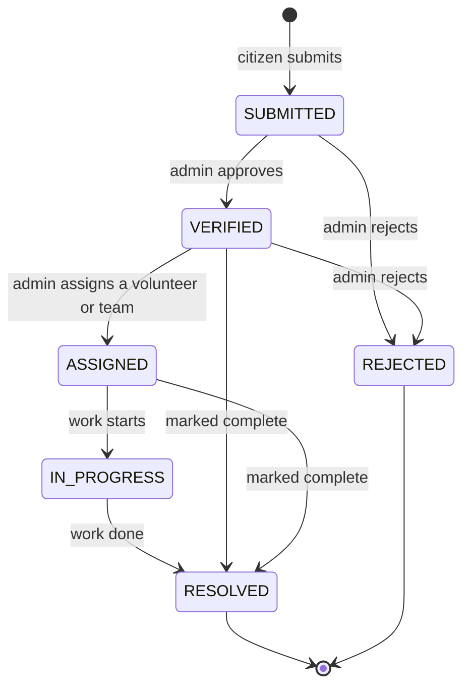
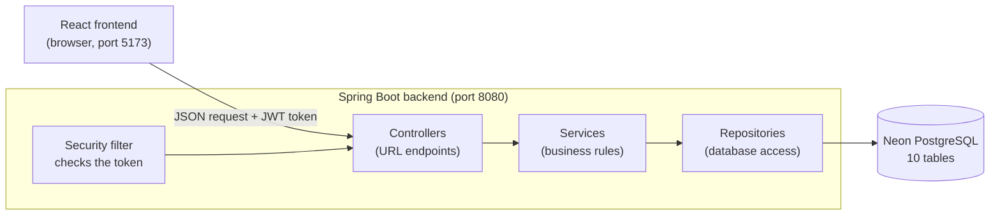
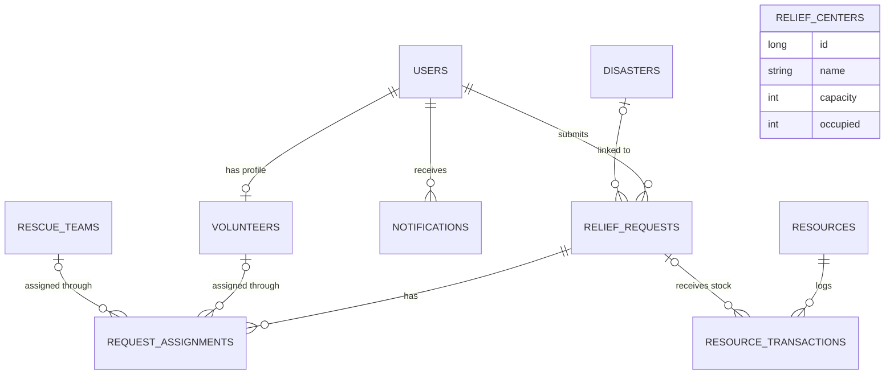
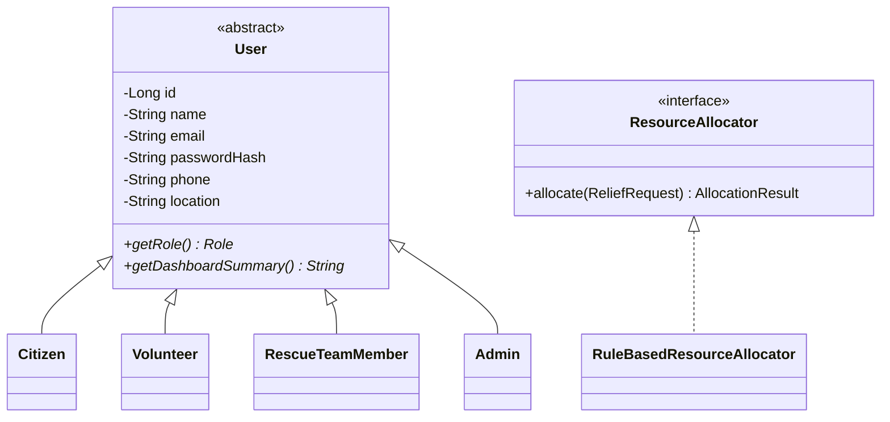

# Disaster and Flood Relief Management System

Presentation notes for the OOP micro-project. The web app is branded Resilio in the UI.

This is a four-person college project. I built the backend: the Java REST API, the database design, security, and the logic behind every feature. A teammate built the React frontend, and I connected the two so the whole app runs on real data.

Code: https://github.com/ritvikpradeep-23/OOPS-PROJECT

## The problem

When a flood or earthquake hits, help requests arrive faster than anyone can sort them. Citizens call or message whoever they can reach. Relief stock sits in depots without anyone knowing what is running low. Volunteers turn up but nobody tells them where to go. The same family can get help three times while the next street gets none.

The project gives every party one shared system. Citizens ask for help. Admins see every request, sort them by urgency and send people and supplies. Volunteers receive tasks and confirm them.

## What the app does

A citizen opens the app and submits a request for help, such as food, medical help, shelter or rescue. They give a location, the number of people affected and a priority. An admin reviews the request and approves or rejects it. Then the admin assigns an approved volunteer with a date and time. The volunteer accepts or declines the task from their own screen. Every step sends a notification to the person it affects, and the citizen can track the status of their request the whole way.

Alongside that flow, admins manage disasters on a map, relief centers (shelters) with capacity, an inventory of relief supplies, user accounts and system-wide emergency broadcasts.

### Who uses it

| Role | What they can do |
|---|---|
| Citizen | Register, submit and edit help requests, track status, view disasters, shelters and supplies, apply to volunteer |
| Volunteer | Everything a citizen can, plus accept or decline assigned tasks |
| Rescue team | A separate role for rescue staff accounts; rescue teams themselves are managed as units by the admin |
| Admin | Manage disasters, requests, resources, relief centers, volunteers, rescue teams and users; broadcast alerts; run smart allocation |

## How a request moves through the system

Every relief request follows a fixed set of states. The backend rejects any jump that isn't allowed, so a request can't go from "submitted" straight to "resolved" by mistake.



The UI shows simpler labels. Pending means SUBMITTED. Approved covers VERIFIED, ASSIGNED and IN_PROGRESS. Completed means RESOLVED.

A citizen can edit their request only while it is still pending. If the same citizen submits the same type of request for the same disaster within 30 minutes, the backend refuses it as a duplicate.

## Features by module

The assignment brief asked for nine modules. All nine are built.

| # | Module | What it does |
|---|---|---|
| 1 | Authentication and users | Register and log in with a JWT token, view and edit your profile, admin manages accounts |
| 2 | Disaster management | Admin creates, edits and deletes disasters with type, severity, status, location and map coordinates |
| 3 | Relief requests | Citizens submit requests; status flow; duplicate detection; admin approves, rejects and assigns |
| 4 | Resources | Supply inventory with quantity and minimum level; low-stock flag; every allocation and restock is logged |
| 5 | Relief centers | Shelters with capacity, occupied count, facilities and availability |
| 6 | Rescue teams and volunteers | Volunteer applications with admin approval; rescue team units; assignments with a scheduled time |
| 7 | Smart allocation | Rule-based matching of verified requests to available supplies, most urgent first |
| 8 | Admin dashboard | Counts of active disasters, pending and resolved requests, stock, shelter occupancy and active volunteers |
| 9 | Notifications | Created automatically on status changes, assignments, applications and broadcasts; users can read and delete them |

## Architecture

The app is two separate programs. A React frontend runs in the browser, and a Java backend server owns all the data. They talk over HTTP using JSON.



The backend uses a layered design. Each layer has one job.

| Layer | Job | Example |
|---|---|---|
| Controller | Receives the HTTP request, checks the role, returns JSON | `ReliefRequestController` |
| Service | Applies the rules: status flow, duplicates, ownership, notifications | `ReliefRequestService` |
| Repository | Reads and writes the database; Spring generates the SQL | `ReliefRequestRepository` |
| Model (entity) | A Java class that maps to one database table | `ReliefRequest` |
| DTO | The shape of data sent over the API, separate from the entity | `ReliefRequestResponse` |

What happens when a citizen clicks "Submit SOS":

1. The React page sends `POST /api/requests` with the form data and the user's token.
2. `JwtAuthFilter` checks the token and works out who the user is.
3. `ReliefRequestController` passes the data to the service.
4. `ReliefRequestService` checks for a duplicate, saves the request and notifies every admin.
5. The repository writes the row to the `relief_requests` table in Neon.
6. The API returns the saved request as JSON, and the page shows "Request submitted".

## Tech stack

| Part | Technology | Why |
|---|---|---|
| Language | Java 17 | Required by the course; strong OOP support |
| Backend framework | Spring Boot 3.3 | Handles the web server, database and security setup so we write only the app logic |
| Database access | Spring Data JPA with Hibernate | Maps Java classes to tables; writes most SQL for us |
| Security | Spring Security, JWT (jjwt library), BCrypt | Stateless login tokens and hashed passwords |
| Database | Neon (serverless PostgreSQL) | Free hosted Postgres; nothing to install on our laptops |
| Validation | Jakarta Bean Validation | Rejects bad input, such as a missing email, before it reaches the logic |
| Build | Maven | Downloads libraries and builds the project |
| Boilerplate | Lombok | Generates getters, setters and constructors |
| Frontend | React 19, Vite 6, React Router 7 | Built by the frontend teammate |
| Maps | Leaflet with OpenStreetMap | Shows disasters, shelters and requests on a map |
| HTTP client | Axios | Sends API calls and attaches the token to each one |
| API testing | Postman collection (54 requests) | Lets anyone test every endpoint without the UI |

## Database design

Ten tables, created automatically from the Java entity classes when the backend starts.



| Table | Holds |
|---|---|
| `users` | Every account; the `role` column says which kind of user it is |
| `disasters` | Name, type, severity, status, location, affected count, latitude and longitude |
| `relief_requests` | Who asked, for what, how urgent, where, how many people, current status |
| `request_assignments` | Which volunteer or rescue team is assigned to which request, and when |
| `rescue_teams` | Team name, contact, location, availability |
| `volunteers` | Volunteer profile linked to a user: skills, approval status, availability |
| `resources` | Supply items with category, quantity and minimum required |
| `resource_transactions` | A log of every allocation and restock |
| `relief_centers` | Shelters with capacity and occupancy |
| `notifications` | Messages for each user, with read or unread state |

## OOP concepts (the graded part)

The brief requires six OOP concepts. Each one is used in real working code, and the table says where to point when asked.

| Concept | Where it is | One-line explanation |
|---|---|---|
| Encapsulation | Every class in `model/` | Fields are private; access goes through getters and setters |
| Inheritance | `User` and its four subclasses | `Citizen`, `Volunteer`, `RescueTeamMember` and `Admin` all extend `User` |
| Polymorphism | `getDashboardSummary()` and `getRole()` | Each subclass gives its own version; Java picks the right one at runtime |
| Abstraction | `ResourceAllocator` interface, abstract `User`, abstract `AppException` | Callers depend on what a thing does, not how |
| Collections | Request state machine, category map, sorted lists | `Map`, `Set`, `List`, streams and `Comparator` |
| Exception handling | `exception/` package | Custom exception classes and one global handler that turns them into clean error responses |

### Encapsulation

All entity fields are `private`. Other classes read and change them only through getters and setters. The password is stored as a BCrypt hash in `passwordHash` and marked `@JsonIgnore`, so it can never appear in an API response. The API also never returns entity objects directly. It returns DTOs (data transfer objects), which contain only the fields meant for the outside.

### Inheritance

`User` is an abstract class. Four classes extend it.



All four subclasses live in one `users` table. JPA's single-table inheritance strategy uses the `role` column to remember which subclass each row is. When the app loads a user whose role is `ADMIN`, Hibernate builds an `Admin` object. We chose single table because every user type has the same columns, and it avoids joins on every login.

At registration, `AuthService` creates the right subclass from the role in the form:

```java
return switch (request.role()) {
    case ADMIN -> new Admin();
    case CITIZEN -> new Citizen();
    case VOLUNTEER -> new Volunteer();
    case RESCUE_TEAM -> new RescueTeamMember();
};
```

### Polymorphism

`User` declares two abstract methods, and each subclass overrides them.

```java
// in Admin
@Override
public String getDashboardSummary() {
    return "Admin dashboard: aggregate system-wide relief operation statistics and manage all modules.";
}

// in Citizen
@Override
public String getDashboardSummary() {
    return "Citizen dashboard: submit relief requests, track their status, and view nearby relief centers.";
}
```

`UserService.getDashboard(User currentUser)` calls `currentUser.getDashboardSummary()` without knowing the subclass. Java runs the version that matches the logged-in user. `GET /api/users/me/dashboard` returns a different message for a citizen and an admin, from the same line of code.

`getRole()` works the same way. Spring Security calls it to build each user's permissions, and the subclass answers.

### Abstraction

The smart allocation module is written against the `ResourceAllocator` interface. `AllocationService` only knows that something can `allocate(request)`. The rule-based logic sits in `RuleBasedResourceAllocator`. A smarter allocator could replace it later without any change to the service or controller.

`AppException` is another example. It is an abstract class with an abstract `getStatus()` method, and each concrete exception says which HTTP status it means.

### Collections

The request status rules are a `Map` from each status to the `Set` of statuses it may move to:

```java
private static final Map<RequestStatus, Set<RequestStatus>> ALLOWED_TRANSITIONS = Map.of(
        RequestStatus.SUBMITTED, Set.of(RequestStatus.VERIFIED, RequestStatus.REJECTED),
        RequestStatus.VERIFIED, Set.of(RequestStatus.ASSIGNED, RequestStatus.REJECTED),
        RequestStatus.ASSIGNED, Set.of(RequestStatus.IN_PROGRESS),
        RequestStatus.IN_PROGRESS, Set.of(RequestStatus.RESOLVED)
);
```

Other uses:

- `Map<RequestType, List<String>>` maps a request type to the supply categories that can satisfy it.
- Pending requests go into a `List`, sorted with a `Comparator` on the priority score.
- Repositories return `List` and `Optional` results, which services filter and map with streams.

### Exception handling

The `exception/` package holds one abstract base class and five custom exceptions.

| Exception | HTTP status | Thrown when |
|---|---|---|
| `ResourceNotFoundException` | 404 | An ID doesn't exist, such as `/api/disasters/999` |
| `DuplicateRequestException` | 409 | A citizen repeats a request within 30 minutes, or applies to volunteer twice |
| `InvalidStatusTransitionException` | 400 | A status change breaks the rules, or a non-pending request is edited |
| `UnauthorizedActionException` | 403 | A user touches another user's request or assignment |
| `EmailAlreadyExistsException` | 409 | Someone registers with an email that is taken |

`GlobalExceptionHandler`, a class marked `@RestControllerAdvice`, catches these anywhere in the app. It also catches validation errors, wrong passwords and access-denied errors. These errors come back in one JSON shape (timestamp, status, error, message), so the frontend can show the message to the user.

## Smart resource allocation

The allocation is rule-based. There is no machine learning, which is what the brief asked for.

1. Every priority has a score: Critical 4, High 3, Medium 2, Low 1.
2. The batch run (`POST /api/allocation/run`) takes every VERIFIED request and sorts it by score, highest first. Critical requests get stock before low ones.
3. For each request, a map gives the matching supply categories. Food maps to food. Medicine and medical help map to medicine. Shelter maps to blankets and clothing. Rescue maps to emergency kits.
4. It finds every resource in those categories that still has stock.
5. It ranks them, with resources in the same location as the citizen first, then the ones with the most stock.
6. It takes one unit from the best match, logs an ALLOCATION row in `resource_transactions` and notifies the citizen.
7. If nothing matches, it returns a message saying no stock was available.

An admin can also allocate for a single request with `POST /api/allocation/requests/{id}`.

Location matching compares the place name strings. The project has a haversine helper (`DistanceUtil`) that calculates the real distance between two map points. Using it for allocation is the obvious next step now that resources have coordinates.

## Security

- Passwords are hashed with BCrypt before they are saved. The database never holds a plain password.
- Logging in returns a JWT (JSON Web Token). The token is signed with a secret key the server knows. It holds the user's email, ID and role, and expires after 24 hours.
- The frontend stores the token and sends it with every request in the `Authorization: Bearer ...` header.
- `JwtAuthFilter` checks the signature and expiry on every request. The server keeps no session, so this design is called stateless.
- Admin-only endpoints carry `@PreAuthorize("hasRole('ADMIN')")`. A citizen calling one gets 403 Forbidden.
- Ownership checks stop a citizen from reading or editing someone else's request, even with a valid token.
- A missing or expired token returns 401. The frontend then logs the user out and sends them to the login page.
- Database credentials and the JWT secret come from environment variables. They are not written in the code.

## Connecting the frontend and backend

The frontend first stored everything in the browser's localStorage, so data vanished on another computer and nothing reached the database. I rewired every page to call the API.

The UI and the backend use different words for the same things. One file, `frontend/src/services/backend.js`, translates between them, so the pages and the Java enums didn't need to change.

| UI shows | Backend stores |
|---|---|
| Role User / Admin | `CITIZEN` / `ADMIN` |
| "Medical Assistance", "Food & Water Ration", "Evacuation Support", "Shelter Required" | `MEDICAL_HELP`, `FOOD`, `RESCUE`, `SHELTER` |
| Pending / Approved / Rejected / Completed | `SUBMITTED` / `VERIFIED`, `ASSIGNED`, `IN_PROGRESS` / `REJECTED` / `RESOLVED` |
| Priority high / medium / low | `CRITICAL` / `HIGH` / `LOW` |

Wiring the UI also needed backend additions. Disasters gained a name and an affected count, and volunteers gained admin approval. Assignments got a scheduled time and accept or decline. Requests can now be edited and deleted, notifications deleted, and alerts broadcast. A public stats endpoint feeds the login screen.

## Problems we hit and how we fixed them

| Problem | Fix |
|---|---|
| The duplicate check would never match a request with no disaster linked, because SQL `= NULL` is never true | A second repository query that uses `IS NULL` for that case |
| `LazyInitializationException`: Hibernate can't load a request's citizen once the database session has closed | `@Transactional` on the services, so the session stays open until the response is built |
| Any logged-in user could read any request by changing the ID in the URL | An owner-or-admin check in the service, returning 403 |
| Deleting a user would break foreign keys, because their requests, notifications and assignments still point at them | Delete or detach the dependent rows first, in one transaction |
| Frontend labels didn't match backend enums | One adapter file that maps both ways |

## In the UI and API only

Most features have screens. A few exist only in the API for now, and the Postman collection covers them.

| In the UI | API only (use Postman) |
|---|---|
| Login, register, profile | Smart allocation run |
| Submitting, editing, tracking and completing requests | Rescue team management |
| Approving, rejecting and assigning requests | Restock logging and the transaction history |
| Disasters, relief centers and resources | The admin dashboard stats endpoint (the UI counts from the lists instead) |
| Volunteer applications and accepting tasks | The polymorphic `/api/users/me/dashboard` message |
| Notifications and broadcasts, users, reports, map | |

The Settings pages save their toggles in the browser only.

## Known limitations and next steps

- Anyone can register as an admin from the sign-up page. That makes the demo easy, but a real system would let only an existing admin create admins.
- Allocation matches locations by name. The next step is to use the haversine distance with each resource's coordinates.
- Allocation gives one unit per request. The request doesn't yet say how many units it needs.
- Tables are created by Hibernate (`ddl-auto=update`). A production system would use versioned migrations such as Flyway.
- Deployment is planned: the frontend on Vercel, and the backend on a Java host such as Render or Railway, because Vercel doesn't run Java servers.
- There are no automated tests yet. Testing was manual, through Postman, curl and the browser.

## Demo script

Run the backend and frontend first (commands are in `README.md`), then open http://localhost:5173.

1. Log in as the admin: `admin@disasterrelief.local` / `Admin@123`, with the Admin / Officer tab selected.
2. Create a disaster in Manage Disasters with coordinates, and show it appearing on the map.
3. Add a relief center and a resource such as "Rice bags", category food, quantity 50.
4. In a second browser window (or a private window), register a citizen and log in.
5. As the citizen, submit a Food & Water request. Show it in My Requests as Pending.
6. Submit the same request again and show the duplicate error from the backend.
7. Register a second user, open Volunteer and click Apply as Volunteer.
8. As the admin, approve the volunteer, approve the citizen's request, then assign the volunteer with a date and time.
9. As the volunteer, show the assigned task and click Accept.
10. As the citizen, open Notifications and show the trail of updates, then mark the request complete.
11. In Postman, run "Allocate for one request" on the citizen's request to show smart allocation; the rice stock drops from 50 to 49. Then call `/api/users/me/dashboard` with each token to show polymorphism.
12. With the citizen's token, call an admin endpoint in Postman to show the 403 response.

## Questions we might get

Why Spring Boot?
It sets up the web server, database connection and security for us. Our code is then mostly the app's own classes, which keeps the OOP design easy to see.

Why single-table inheritance and not a table per subclass?
All four user types share the same fields. One table means no joins when someone logs in, and the `role` column tells Hibernate which subclass to build.

Where exactly is polymorphism used at runtime?
`UserService.getDashboard()` calls `getDashboardSummary()` on whatever `User` is logged in. Spring Security calls `getRole()` the same way to decide permissions.

Why return DTOs instead of entities?
DTOs keep the password hash and internal links out of the API. They also stop JSON conversion from triggering extra database loads.

How are passwords stored?
As BCrypt hashes. Login hashes the typed password and compares the result.

What is a JWT, and why stateless?
It is a signed token holding the user's identity and role. The server checks the signature on every request, so it doesn't keep session state and can restart without logging anyone out.

How do you stop users seeing each other's requests?
The service compares the request's owner with the logged-in user and throws `UnauthorizedActionException` (403) unless they match or the user is an admin.

What counts as a duplicate request?
Same citizen, same request type and same disaster within 30 minutes. The API answers 409 Conflict with a message.

How does allocation decide who gets stock first?
Priority score, highest first. Then for each request it picks the matching category, preferring stock in the citizen's own location and then the largest stock.

What does `@Transactional` do?
It runs a whole service method in one database transaction. Either every change saves or none does, and related data stays loadable until the method finishes.

How are the tables created?
Hibernate reads the entity classes at startup and creates or updates the tables in Neon.

Why Neon?
It is hosted PostgreSQL with a free tier. Every team member connects to the same database without installing anything.

## Numbers to quote

| Item | Count |
|---|---|
| Java source files in the backend | 107 |
| REST controllers | 13 |
| API endpoints | 50 |
| Database tables | 10 |
| User roles | 4 |
| Modules from the brief | 9 of 9 |
| OOP concepts demonstrated | 6 of 6 |
| Custom exception classes | 5, plus an abstract base |
| Frontend pages | 23 |
| Postman test requests | 54 |
